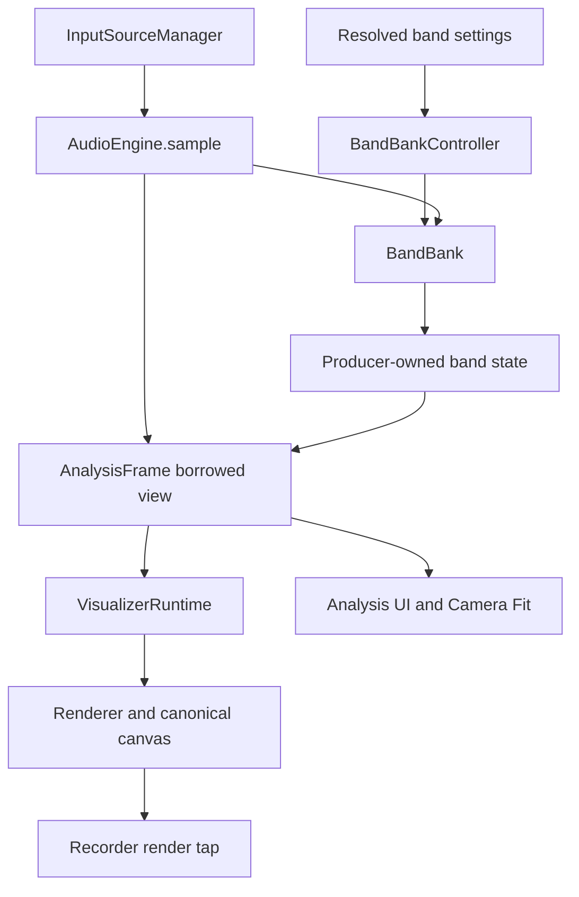

# Build 117 architecture preparation checkpoint

**Date:** November 2, 2026 (America/Los_Angeles). **Delivery:** documentation for design/integration review. The owner-directed goal is modular Analysis and Visualization cores, preparing for later dynamic BandBank bucketing and TemporalEngine. This checkpoint establishes neither a completed performance baseline nor an approved implementation contract.

[AGENTS](../../AGENTS.md) owns engineering policy; [ROADMAP](../../ROADMAP.md#build-117-ux-and-performance-hardening) owns scope/acceptance; the [specification draft](auralprint-build-117-spec-draft.md) owns detailed proposed requirements. The [original Stage 0/1 checkpoint](build-117-stage-0-1-checkpoint.md) and [B0–B2 archive](build-117-baseline.md#evidence-and-remaining-gates) retain their historical evidence. This document reconciles the November 2 owner clarification; it does not create a second policy authority.

## Reference and scope

| Reference | Verified identity / use |
| --- | --- |
| Accepted branch base | `v117_dev` at `dfb57e59b7d22a94be1c768ffc905141ec274ad3`; merge of #108. Tree `e2ddefc793477e547e19b66133defbf46fc7a643` matches the inspected local checkout |
| Working branch | `docs/117-baseline-architecture-contract`, created directly at that accepted commit |
| Current `main` | `75e26348848f874329ca1ac95bb13576371ed2da`; pinned comparison, not a floating benchmark target |
| Common pre-117 reference | `8c21846d4433376fc4568bc51810075fb42385c7`; includes completed hosted packaging #106 |
| Immutable behavioral artifact | `docs/Canon/0.1.16/auralprint_0.1.16.html`; SHA-256 `a7ccb6d0cffdc6641f7cc08fbce71b7087196b962267efae663819b2701d89db`; version `v0.1.16`, writer schema 16 |
| Excluded candidate | PR #109, open/unmerged at `5c01ba4cce8b36c1bdfb439771020c90d4f16b69`; **on hold**. No commits or implementation from it are used |

Remote refs were checked through GitHub. A direct tree comparison confirms `src/`, production build/assembly/distribution inputs, package files and `version` match both pinned `main` and the common pre-117 reference. Branch histories differ; implementation equivalence does not imply branch equality. All **93** file hashes in the existing reference's `implementationFiles` match the accepted checkout. The four archived harness-file hashes match `43cfefe`; the current harness includes later reporting labels. The archive's original dirty-state/source declaration is retained, not rewritten as a clean run at today's commit.

The Canon checksum and archived gzip checksum were independently verified. The [baseline completion ledger](build-117-baseline.md#baseline-completion-ledger) is the current coverage inventory: B0–B2 evidence exists; B3–B7, exact Hero and representative device/lifecycle evidence remain open. No new performance result is claimed here.

**Scope:** reconcile existing planning owners, record actual dependencies and prepare bounded assignments. Production source, tests, fixtures, benchmark code/data, Canon, configuration, schemas, version and PR #109 are outside this documentation patch. No Canvas skill installation or new build process is included.

## Current dependencies (source-proven)

This is the accepted implementation, not the proposed target topology. In [`main.js`](../../src/js/main.js), analysis runs on every delivered application rAF even with zero Orbs; it is independent of Visualizer demand, but currently shares the application callback cadence. Source/recorder asynchronous lifetimes are separate. Do not describe the present Analysis core as an independently scheduled service.

Arrows show data/service dependencies, not cleanup ownership or the complete scheduler. `main.js` calls `updateAnalysisFrame()` after sampling; BandBank writes shared band state, and the frame projects it without copying. The graph does not grant consumers writable access.

| Boundary and source symbols | Current coupling / cadence | Design question and protected behavior |
| --- | --- | --- |
| [`AudioEngine.sample()`](../../src/js/audio/audio-engine.js), [`InputSourceManager`](../../src/js/audio/input-source-manager.js) | AudioEngine owns the analysis graph, L/R/C sampling, RMS/energy and calls into BandBank; source acquisition/cancellation has a separate owner | Separate production and derivation without transferring source/track ownership or gating L/R/C on visible consumers |
| [`BandBankController`](../../src/js/audio/band-bank-controller.js), [`BandBank.rebuild/computeEnergiesFromAnalyser`](../../src/js/audio/band-bank.js) | Resolved settings plus actual sample rate define ranges; BandBank replaces arrays on rebuild and updates channel energies/shared dominant data on sampling | Replaceable definitions/aggregation with explicit invalidation; preserve Nyquist, overlap and current numerical/selection meaning |
| [`createAnalysisFrame/updateAnalysisFrame`](../../src/js/audio/analysis-frame.js) | Reused frame and channel objects borrow producer arrays; `ready` is availability, not a revision. No timestamp, sequence or definition-version field exists | Define freshness, source/definition epochs, clock domains and borrowing/snapshot lifetime before caching or future temporal consumers |
| [`CONFIG`](../../src/js/core/config.js), [`normalizeBandCount/sanitizeOrbBandIds`](../../src/js/core/preferences.js), [`preset-codec`](../../src/js/presets/preset-codec.js) | Factory count is 256; current normalization admits integer counts 3–256. Canonical IDs/legacy names use the fixed name table; schema 16 persists existing settings | Do not mistake factory count for an entirely fixed-length implementation, or legal counts for completed dynamic bucketing. Inventory mappings before proposing new definitions/IDs |
| [`selectOrbAnalysis`](../../src/js/render/visualizer-runtime.js), [`Renderer.drawSpectralRing`](../../src/js/render/renderer.js), [`analysis-panel`](../../src/js/ui/analysis-panel.js), [`orb-editor`](../../src/js/ui/orb-editor.js) | Selection bounds depend on energies, name table and ranges; Ring uses resolved band count; editors/UI also read BandBank/shared state directly | A new frame facade alone will not decouple every consumer. Preserve selected-channel averaging/order, genuine combined C, editor identity and preset semantics |
| [`VisualizerRuntime.update/render/reconcile`](../../src/js/render/visualizer-runtime.js), [`orb-runtime`](../../src/js/render/orb-runtime.js) | Explicit Orb/Ring factories and type branches; Orb updates precede governor commit and Ring update; composition paints Ring first | Separate update dependencies, resource barriers and composition; preserve stable survivors, zero Orbs and Ring lock fallback. No general discovery or isolation exists in this accepted source |
| [`TrailSystem`](../../src/js/render/trail-system.js), [`ParticleGovernor`](../../src/js/render/particle-governor.js), [`timing`](../../src/js/core/timing.js) | Trail ownership, shared budget/retention and independent emission/motion/age clocks constrain updates | Resource service participation must be explicit; a new Visualizer need not be a particle emitter. Pause and real-time expiry remain distinct |
| [`Renderer`](../../src/js/render/renderer.js), [`Spaces`](../../src/js/core/spaces.js), [`Camera Fit`](../../src/js/render/camera-fit-content.js), [`RecorderEngine`](../../src/js/recording/recorder-engine.js) | Renderer contains Orb/Ring drawing; Fit enumerates their geometry; canonical canvas is the recording tap. DPR/world/Camera have separate meanings | Move type knowledge through reviewed adapters; preserve Fade 0/positive, blending/order, CSS-sized marks, Fit and recorder-visible output |
| [`build.mjs`](../../scripts/build.mjs), [`visualizers-panel`](../../src/js/ui/visualizers-panel.js), [`UI.applyPrefs`](../../src/js/ui/ui.js) | Fixed JS entry; explicit editor/action dispatch and settings synchronization; expensive all-Orb refresh already measured in B2 | Static discovery, activation, editors and persistence are distinct concerns. Build inclusion must not create instances or a new settings authority |

The existing [protected checks register](build-117-stage-0-1-checkpoint.md#4-protected-checks-and-risk-register) remains the test/fixture map. A new proof supplements it; green new tests cannot replace protected regression evidence.

## Contract decision register (proposed, not an ABI)

| Decision | Alternatives / cost to review | Evidence required before implementation acceptance |
| --- | --- | --- |
| Analysis products and lifetime | Borrowed current-frame views avoid copies; retained snapshots cost memory/copy work; caches need explicit freshness and invalidation | L/R/C parity, source change/no-source, FFT/sample-rate/settings rebuild, replaced buffers and stale consumer behavior; no identity-based freshness inference |
| Band definitions and derived services | Compatibility adapter around current IDs versus a new internal definition model; persisted format remains unchanged | Independent producer/derived module proof, stable legacy/ordered selection meaning, no rewrites of unrelated consumers; separately approve any future wire change |
| Time and scheduling | Delivered-frame time, audio/media time and monotonic age answer different questions; no TemporalEngine contract selected | Specify units, domains, pause/background/rebase and source-switch behavior; future consumer can distinguish invalid/stale data without implicit retained history |
| Visualizer type/instance contract | Required versus optional capabilities, singleton admission, settings replacement, build discovery and runtime activation | Independent non-audio type with no fake particle methods; add/remove/invalid metadata; both editions; stable survivors and zero instances |
| Dependency/resource ordering | Explicit dependencies/barriers with stable tie order versus implicit central type cases | Orb update → governor commit → Ring update, Ring-first drawing; absent optional provider, cycle rejection and partial creation/cleanup failures |
| Drawing and failure behavior | Direct drawing, validated commands/reusable batches, scratch surfaces, hybrid; include allocations, surface bytes, clear/composite work and validation cost | Same-workload pixels, pacing, memory and recorder checks at relevant sizes/DPR. Define what happens after a partial draw; do not assume command validation or Canvas state restoration rolls pixels back |
| Geometry, Fit and UI capabilities | World units/fractions, CSS/backing pixels and desired/min/max output extents need explicit ownership and unsatisfied-request behavior | Unchanged simulation/history under view changes; correct screen-sized marks/Fit; truthful inventory and independent editor ownership |
| Migration and recovery | Compatibility adapters around each current owner versus wider coordinated replacement; rollback must remain possible at review boundaries | Dependency-ordered file/interface changes, version/deprecation policy for incompatible boundaries, partial failure/reset/disposal tests and a complete rollback to the prior accepted WIP |

These are architecture hypotheses and review requirements. The modularity goal is owner-directed; particular abstractions, caches, scheduling policies, command vocabularies, renderer backends and schema changes are not approved. The original Visualizer proposal remains useful input, and PR #109 may later be studied under a separate assignment.

## Bounded next assignments and review stops

| Stop | Assignment / deliverable | What remains gated |
| --- | --- | --- |
| Documentation readiness (this pass) | Pinned references, honest coverage ledger, both-core dependency map and explicit unresolved choices | No Stage 0/1 promotion or production implementation |
| A — Reference | Implement/measure B3/B4 first using the [setup and evidence rules](build-117-baseline.md#next-measurement-assignments-and-stop-points); then separate B5, B6 and B7 passes. Collect Hero/device evidence or explicit owner qualifications | Review every required workload/qualification before accepting the complete reference |
| B — Design | Write candidate Analysis and Visualization contracts together with lifecycle/ownership, alternatives, migration order and rollback. Research may proceed during A | Owner settles the decision register before an implementation is treated as the target architecture |
| C — Isolated proofs | Separately assigned replaceable Analysis producer/derived service and independent statically discovered Visualizer; positive, negative and native integration evidence | Proof acceptance does not authorize Orb/Ring migration, default activation or a preset schema |
| D — Migration | One protected boundary per reviewable pass, preserving legacy adapters and current behavior; compare with fixed 116 and preceding accepted WIP | Performance claims and UX changes remain separate; stop on incomplete parity rather than leave half-migration |
| E/F — Optimization, then interfaces/integration | Matched pacing/resource/fidelity evidence; capability-driven responsive UI, source/Queue/recording/soak and accessibility coverage | Owner-approved tradeoffs and separate release gates |

A–F are review gates, not replacement roadmap stage numbers. The first assignable coding pass is the B3/B4 baseline extension; its scope is harness/tests/new evidence, not production optimization. Its setup/classification decision must be reviewable before expensive runs. Analysis contract design is the next design/integration pass, using this map and the outstanding reference limitations.

Every coding assignment must name exact baseline, affected ownership/interfaces, intended files, hypotheses/alternatives, prerequisites, negative/parity proof and failure/rollback plan before edits. Its PR must report each acceptance criterion as **pass / fail / unverified / owner-accepted exception**, with exact source/artifact hashes, raw evidence, platform limits and remaining work. An unrelated improvement or CI pass does not close an unproven criterion.

## Verification and handoff

Local verification on Linux, Node 24.22.1, npm 11.9.0 and Python 3.12.14:

- `npm test`: **1,555 passed, zero failed, one existing opt-in skip**. Dependencies were reused from an installation with byte-identical package/lock files; `npm ls --depth=0` confirms esbuild 0.25.12 and Playwright 1.64.1. This was not a fresh `npm ci`.
- `npm run build` and `python scripts/verify_distribution.py` passed. Generated portable HTML is byte-identical to Canon 116; hosted HTML SHA-256 is `e69fb1c3479381226c2ba353dd17222352b5d3bb8271f61e0fc3468321572e36`, matching the archived reference.
- Canon/reference archive checksums, all 93 archived implementation hashes, 85 local documentation links/fragments, the exact five-file documentation path set and `git diff --check` passed. Production/protected paths and original benchmark data are unchanged.
- Native browser checks and fresh benchmarks were not run for this documentation-only patch. PR CI, physical devices, B3–B7 and Hero evidence are separate; no new platform/performance result is inferred.

The PR records the delivered commit and CI state. Historical Watcher duplicate-save, Windows child-survival/rename causes and platform qualifications remain open; no claim of repair follows from a passing check.

The reviewable result is a documentation branch from accepted work. The next stop is owner review of this reconciliation and the B3/B4 assignment, with detailed architecture decisions still open. No merge, deployment, Canon change or milestone promotion is included.
## Follow-on F0 invariant registry (November 6, 2026; review candidate)

The [F0 Canon 116 invariant and boundary registry](build-117-f0-invariant-registry.md) maps protected source owners, falsifying counterexamples, existing regression-test pointers, and unresolved cross-boundary proof obligations. It is a later, documentation-only review artifact: it does not retroactively change this November 2 checkpoint's evidence, close Stage 0, approve Stage 1 contracts, integrate held PR #109, or authorize migration. AGENTS and ROADMAP remain authoritative.
