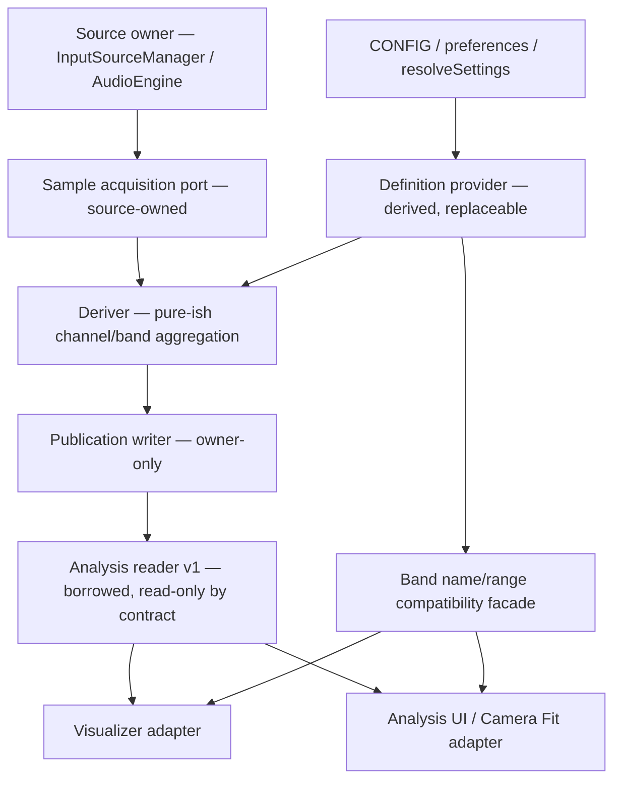

# Build 117 F1 — Modular Analysis contract candidate

**Status:** design/review candidate (not an accepted ABI or implementation authorization). **Date:** 2026-11-06. **Authoring role:** Axiom, invariant-first architecture review.

**Pinned accepted base:** `v117_dev@ff547056542a10e3fbf1ae2010248d4558e55dda`; F1 branch starts at this SHA, not from unaccepted F0. **Immutable behavior oracle:** Build 116 / Release 5, `v0.1.16`, preset schema 16. **Related but unmerged:** [F0 PR #111](https://github.com/cosmicdance-4-2-0/Auralprint1/pull/111), which inventories existing promises; [Visualizer PR #109](https://github.com/cosmicdance-4-2-0/Auralprint1/pull/109), on hold. Neither PR is accepted by this document.

[AGENTS](../../AGENTS.md) governs binding engineering constraints; [ROADMAP](../../ROADMAP.md) governs Stage 0/1 acceptance and Stage 3 execution; [architecture preparation](build-117-architecture-preparation.md) is the accepted-base source map; [117 draft specification](auralprint-build-117-spec-draft.md) records architecture objectives. This F1 document adds **candidate decisions** and proof obligations without revising that authority hierarchy.

## 1. Mission, non-goals, and what constitutes proof

**Objective:** define the smallest replaceable Analysis producer/derivation/consumer boundary that can preserve the current **L/R/C**, frequency, dominant, preset, and lifecycle meanings, while making data freshness and borrowing validity explicit. Prepare replaceability for later BandBank definitions and TemporalEngine without implementing either feature.

**Not authorized by F1:** changing source/transport/recorder ownership, switching to an independent analysis thread or cadence, adding snapshots/caching, changing FFT or spectral math, implementing Build 118 selection, adding TemporalEngine, writing a new Scene/preset schema, changing CONFIG, optimizing performance, migrating runtime consumers, modifying the held Visualizer PR, or advancing milestones/releases. `contractVersion: 1` below is a **proposed internal interface version**, not the published preset schema.

**Separation of evidence:** source inspection and existing tests prove current structure/covered assertions, not acceptance of the new interface. The candidate tests in §7 are **unexecuted proof specifications**; an independent producer/consumer implementation must pass them at a later separately approved proof gate. No current F1 runtime or automated test result is claimed.

## 2. Observed accepted source: coupled boundaries and exact semantics

| Boundary | Present behavior at pinned base | Required preservation or isolation |
| --- | --- | --- |
| [InputSourceManager](../../src/js/audio/input-source-manager.js) / [AudioEngine](../../src/js/audio/audio-engine.js) | Own source winning/cancellation, Web Audio graph, per-channel analysers and buffer allocation. `AudioEngine.sample()` calls L, R, then C time-domain/frequency sampling and derives levels, mono detection, band energies and C global dominant synchronously. | **Do not transfer source or analyser ownership to subscribers.** A replaceable analytical producer may be invoked by the established coordinator without getting direct permission to stop source-owned tracks. |
| [BandBankController](../../src/js/audio/band-bank-controller.js) / [BandBank](../../src/js/audio/band-bank.js) | Controller synchronizes resolved count/floor/ceiling/mode and actual sample rate; rebuild replaces band edges and distinct L/R/C energy arrays, clamping effective ceiling to Nyquist. `readBandDefKey` includes settings, not the actual sample rate. | Treat *successful active-definition replacement* separately from preference edits or an unchanged configured ceiling. Keep derived metadata and arrays coherent with current audio graph. |
| [AnalysisFrame](../../src/js/audio/analysis-frame.js) / [main.js](../../src/js/main.js) | A stable frame and channel objects borrow producer-owned arrays. `updateAnalysisFrame(frame, AudioEngine.sample(), state.bands)` runs every delivered application rAF before visualizer update, UI projection and scrubber; `ready` is availability, not a freshness token. | Preserve B116 consumer shape through an adapter; do not use frame-object or array-object equality to infer sample freshness. Analysis must continue with zero visualizers even if future scheduling is changed. |
| [VisualizerRuntime](../../src/js/render/visualizer-runtime.js), [Renderer](../../src/js/render/renderer.js), [Camera Fit](../../src/js/render/camera-fit-content.js) | Read borrowed L/R/C channels, global C spectrum and current-frame data; Orb selection averages its selected channel energies, empty selection uses its full-channel energy. | Preserve exact channel meaning, first-tie selected dominant, true global C, Ring and projection behavior. New consumer port must not smuggle Web Audio internals into visualizers. |
| [Analysis Panel](../../src/js/ui/analysis-panel.js), [Orb Band Picker](../../src/js/ui/orb-band-picker.js), [Orb Editor](../../src/js/ui/orb-editor.js), [UI coordinator](../../src/js/ui/ui.js) | Read some `state.bands`, `BandBank` range formatters, `BAND_NAMES` and `runtime.settings` directly. `UI.applyPrefs` decides definition rebuild and live analyser settings; `resetTrackVisualState` zeros energies and dominant directly. | **A new AnalysisFrame alone is insufficient.** Preserve user-facing names/indices/edit precision; migrate each data/definition reader and reset command through its owner, with one writable setting owner. |
| [Preset codec](../../src/js/presets/preset-codec.js) / [preferences](../../src/js/core/preferences.js) | Persist configuration, not live energy buffers, source metadata, capture/playback, or an AnalysisFrame. Schemas 2–13 immutable; writer 16; 14/15 reserved. | Adapter changes must be wire-neutral. New internal revisions/epochs never appear in schema-16 or runtime settings as a second persistence source. |

**Source-observed subtlety:** `AudioEngine.sample()` samples C through its dedicated graph path *after* L/R mono detection and adaptive center mixing. Treat C as the existing **measured combined channel**, not an inferred `(L+R)/2` post-processing convenience. Preserve its normalization, spectrum and dominant tie semantics, including silent/mono-like cases.

**Source-observed invalidation risk to test, not a diagnosed production bug:** `BandBankController.onAudioContextKnown()` reports a rebuild when sample rate becomes known or when the effective ceiling changes. A hypothetical transition from one known sample rate to another with an unchanged effective ceiling does not trigger by that test alone. The existing AudioContext lifecycle may make that path unreachable today. F1 must nonetheless treat a new actual sample rate as a definition/metadata input and test this exact case, without claiming Build 116 was faulty.

## 3. Proposed owners and dependency direction



These arrows represent **read/data dependencies**, not transfer of cleanup authority. The application coordinator owns invocation order. The native source manager retains resource cancellation and graph ownership. A reader must never be able to call the writer's mutation methods. In the first migration the current `AudioEngine`, `BandBank` and `AnalysisFrame` remain authoritative behind adapters: a new service must not become a second source of writable state.

| Candidate service boundary | Allowed responsibility | Explicitly excluded |
| --- | --- | --- |
| **Acquisition** | Provide genuine current L/R/C waveform, RMS/level and frequency data from an accepted source through owned buffers. | Native graph/source ownership delegation, alternate source lifecycle or extra sampling loop. |
| **Definition** | Derive ordered band edges/metadata from canonical resolved settings and actual sample rate; supply existing names/range formatting and immutable-meaning IDs. | Persisting its own settings, implicit dynamic bucketing, rewriting legacy names or changing schema-16 Orb targets. |
| **Derivation** | Compute channel band energies and C global dominant using the accepted algorithm, consuming acquisition and definition. | Consumer-specific Orb policies, visualizer instances, UI mutation and recorder cleanup. |
| **Publication** | Atomically expose internally consistent results and availability, track revisions and invalidation with no Web Audio objects. | Persistent Scene authority, arbitrary consumer writes or retrospective snapshots without explicit ownership and allocation policy. |
| **Consumption** | Synchronously borrow the current publication; validate a captured revision before asynchronous reuse; request an explicitly separate retained copy only if later approved. | Mutating producer buffers, assuming stable object identity means unchanged contents, retaining a live reference as historical audio. |

**First architectural seam:** Acquisition + Definition/Derivation + Publication can be replaced independently behind one consumer contract. This is a *target interface topology* for review; it is not proof of three independently swappable implementations until the isolated Stage 3 trial executes.

## 4. Candidate AnalysisReader v1 — shape and lifetime

The following is **illustrative JavaScript-shaped pseudocode**, not a TypeScript build requirement, implemented signature, frozen ABI or approval to add code:

```js
// Consumer-only port. Construction, ownership and writer functions are private
// to the Analysis core, not methods supplied to Visualizers.
const reader = {
  contractVersion: 1,
  readCurrent(),             // returns a reusable borrowed view, no deep copy
  isCurrent(stamp),          // compares copied scalar revision fields; see below
};

// Proposed borrowed view (references are illustrative, not frozen typed arrays):
{
  publicationRevision,      // runtime-local, changes on invalidation/publication
  sourceEpoch,              // accepted source-graph identity, not request count
  definitionRevision,       // successful active band-definition revision
  ready, monoLike,          // existing availability/mono-like meaning
  observedAtMs,             // monotonic observation end, or null if unavailable
  channels: {
    L: { waveform, rms, energy01, bandEnergies01 },
    R: { waveform, rms, energy01, bandEnergies01 },
    C: { waveform, rms, energy01, bandEnergies01 },
  },
  spectrum: {
    energies01, lowHz, highHz, dominantIndex, dominantName,
    metadata: {
      sampleRateHz, nyquistHz,
      effectiveFloorHz, configCeilingHz, effectiveCeilingHz,
    },
  },
}

// Callers must copy scalar revisions, not retain this changing view as a token.
const view = reader.readCurrent();
if (view.ready) {
  const stamp = {
    publicationRevision: view.publicationRevision,
    sourceEpoch: view.sourceEpoch,
    definitionRevision: view.definitionRevision,
  };
  // Read borrowed arrays synchronously. No await/callback retention.
  // A deferred operation must call reader.isCurrent(stamp) and re-read
  // the current view; it must NOT use old borrowed array references.
}
```

**Identity and monotonicity (candidate):**

1. `publicationRevision` is runtime-local and strictly increases when a borrow is invalidated **and** when a new ready or unavailable publication is committed. A sampling transaction invalidates the previous borrow *before* mutating the reused waveform/energy buffers; it commits only after L, R, C and definition metadata agree. Aborted work remains unavailable, never partially ready. Revisions never reset on track changes; overflow must fail closed rather than silently wrap.
2. `sourceEpoch` identifies the **currently accepted/removed source graph**. It advances only on an owner-confirmed effective source replacement/teardown or equivalent accepted graph identity transition, not on a proposed request, a stale/cancelled request or an ordinary track-time tick. The source owner must supply this lineage; a new Analysis-local counter cannot independently invent accepted-source truth.
3. `definitionRevision` advances on a successful change to the active band definition/metadata, including a changed actual sample rate even if effective ceiling happens to remain numerically identical. It need not advance for unrelated settings changes or ordinary fresh samples. FFT resize invalidates borrowed waveform buffers and increments publication revision even when the ordinal band geometry itself is unchanged.
4. The frame's `ready` indicates available current analysis; it does **not** imply freshness or clock synchronization. A definition can remain available for UI/ranges when `ready=false`; waveform and computed-energy readings must be treated as unavailable. `monoLike=true` on a not-ready frame preserves the legacy fallback.
5. `observedAtMs` is a finite monotonic **observation-end timestamp** sampled from an explicitly injected host clock. It is not PCM presentation timestamp, AudioContext time, media element time, Orb motion `dtSec`, particle age, or proof that all three analyser buffers refer to an identical hardware sample instant. No audio/media clock mapping is selected in F1.
6. No implicit deep copy, per-subscriber buffer clone, background timer, unbounded cache, worker or persistent revision is required. Reuse view and channel wrappers for compatibility; the stamp is a few primitive numbers. Any later retained snapshot interface requires separate allocation and expiration policy.

**Borrowed-view contract:** arrays are **producer-owned and mutable in place**. A current borrow expires at the *beginning* of the next acquisition/definition/source invalidation transaction, not merely when the next frame object is returned. `readCurrent()` is a synchronous, non-owning view; access after `await`, callback retention or an invalidated stamp is unsupported. `isCurrent(stamp)` must return false whenever the publication is unavailable/in-progress or any captured revision no longer matches. A frozen wrapper does not make a typed array immutable or prove lifetime safety; the boundary is a documented cooperative contract, not a sandbox against malicious code.

**No-source/error contract:** explicit accepted teardown or failed current sampling invalidates the prior ready borrow. Any existing band geometry may remain accessible as *definition metadata*, but unavailable/superseded measurement values cannot be consumed as fresh. A sampling exception cannot publish L from one source together with R/C from another. Failed/stale source requests that do not affect the accepted graph must not change `sourceEpoch` or tear down the current publication spuriously.

**Read-only scope:** existing consumers are trusted first-party JavaScript. The consumer port must not expose `AnalyserNode`, `AudioContext`, `MediaStream`, writable source handles or writer methods. Typed-array mutation cannot be prohibited by naming, `Object.freeze` or a simple object facade; malicious untrusted runtime plugins would need a different isolation model, which is out of scope.

## 5. Definition contract and numerical compatibility

Definitions are distinct from measurements. A *definition* includes the current ordered ordinal `0..count-1` band identity, low/high frequency edges (including open-ended top band `Infinity`), distribution mode, configured floor/ceiling, actual sample rate when known, Nyquist, effective floor/ceiling, and compatible display-name lookup. Current sample-array buffers are not the definition's identity.

- **CONFIG supremacy:** the existing settings/normalization/admission rules and `CONFIG.bandNames` remain canonical; new metadata is derived, never a second writable source. Existing `normalizeBandCount()` and `sanitizeOrbBandIds()` must retain their meanings.
- **Actual sample rate:** `effectiveCeilingHz = min(configuredCeilingHz, actualSampleRateHz / 2)` when sample rate is known. A configured floor above Nyquist yields the established collapsed/zero-width interior behavior; zero-width bands cannot consume the final energized FFT bin.
- **L/R/C:** energy per band is computed from the *selected channel's* analyser, with current clipping/normalization/bin membership and tie semantics; C spectrum/dominant use the actual combined channel. For an Orb, selected IDs use the selected channel and average valid selected energies; empty targets use full-channel energy. No implicit weighted aggregation or auto-mapping from band names is approved.
- **Index and wire stability:** existing schema-16 numeric IDs stay ordinal IDs with their current meaning. Dynamic future bucket models must be mediated through a reviewed definition/selection adapter and, where persisted meaning changes, a separately versioned schema migration. `definitionRevision` is **not** a preset field.
- **Rebuild transaction:** prepare a complete definition and three compatible per-channel arrays; publish only after validation. A failed rebuild must leave the last accepted definition usable or explicitly mark the publication unavailable—never expose a half-rebuilt low/high/energy combination. UI range queries and the consumer frame must agree on the active definition revision.
- **Performance:** no requirement to recompute band edges per sample or copy arrays for every subscriber. A new definition must not silently increase current FFT work, change bins or reduce default fidelity.

**Compatibility note:** the new definition port is allowed to *report* source/definition revisions and data validity not exposed by Build 116, but it cannot claim those diagnostics already existed in 116. This is an interface improvement to be separately tested and accepted.

## 6. State transitions, failure ownership and compatibility adapters

| Event | Proposed revision/availability behavior | Preserved behavior / counterexample |
| --- | --- | --- |
| Boot, no source | Initial borrowed view unavailable, definitions may be present without audio rate. | Zero Orb/Ring state remains valid; `ready=false` cannot be mistaken for silent valid audio. |
| Successful source attach / accepted source exit | Source owner signals a new epoch and old borrowed measurement is invalidated before buffers change. | Cancellation retains winning source; stale request cannot supersede it. |
| Failed/cancelled competing attach | No committed graph change means no source-epoch advance; old ready frame remains valid until ordinary next sample. | Rejected Mic request cannot invalidate playing File or Stream. |
| Ordinary delivered application frame | Pre-sampling invalidation, synchronous L/R/C derive, atomic ready publication; revision changes while source/definition identities may remain constant. | Reused frame/array identities are not a cache key; same-frame Orb/Ring consume coherent L/R/C. |
| Band count/floor/ceiling/distribution accepted rebuild | Prepare/validate geometry and L/R/C arrays; advance definition revision once; invalidate previous borrows; publish coherent data next sample. | Stable settings/config authority; selected indices, global dominant, and names retain wire meaning. |
| Actual sample rate changes with unchanged effective ceiling | Treat as changed definition/metadata input and invalidate; require a specific negative/positive test. | No stale `sampleRateHz` or Nyquist provenance even when band edges are numerically equal. |
| FFT resize/smoothing configuration | Invalidate before any existing reused waveform buffers are replaced/written; definition revision changes only if band definition/metadata actually changes. | Preserve FFT-size and smoothing selection; no accidental schema or source epoch increment. |
| Track visual reset | Clear/reset through the owning analysis service, not UI writes to `state.bands`; invalidate active measurements as needed, preserve definition. | Existing trail reset and dominant/energy reset remain distinct from change of authored Orb phases. |
| Sampling/derivation throws or partial write | Mark current publication unavailable; never expose partially mixed L/R/C as ready. Source-owner resource release is separately coordinated. | No suppression of real error; no automatic native source teardown without owner intent. |
| Consumer retains reference across `await` | Old stamp fails on new publication/invalidation; re-read before use or request an explicitly approved retained copy. | No implicit replay/TemporalEngine history or unbounded snapshots. |

**Proposed compatibility order (each later step separately reviewed):**

1. **Parity inventory:** pin exact Canon/revision and capture existing L/R/C, state/bands and UI rendering behavior; preserve current tests/fixtures and numerical precision.
2. **Isolated proof only after contract acceptance:** create a synthetic producer + independent consumer using candidate reader/definition ports; exercise all §7 positive and adversarial cases without Web Audio, UI or Orbs. This is **not** production integration.
3. **Read-only bridge:** adapt the existing `createAnalysisFrame/updateAnalysisFrame` to a v1 reader without replacing `AudioEngine.sample()`, `BandBank` or `main.js` cadence. Current consumers retain the legacy shape and behavior until reviewed migrations. Make source/definition invalidation hooks explicit; do not synthesize “source accepted” from an abandoned request.
4. **Consumer migration:** one boundary at a time: Analysis Panel/ranges and UI reset/definition command, Orb selection and Ring, Camera Fit, then other identified direct readers. Maintain one writable owner; no dual-updating state trees or halfway migrated default UX.
5. **Producer/derived replacement trial:** swap one implementation at a time behind the same contract, compare numerics and lifetimes against the Canon source and preceding accepted WIP. Revert the candidate branch to the accepted adapter if proof fails; never mutate frozen schema or Canon.

A single architecture PR cannot silently authorize all five steps. Stage 3 Analysis modularization is separate from Stage 1 F1 design, and Stage 3.5 Visualizer migration remains on hold pending its own decision gates.

## 7. Independent proof matrix — specified, not executed

Each proof needs both an adversarial **negative** case and a meaningful **valid-input control**, with exact input data, owner/source state, expected stamps/arrays and actual result logged. When implementation begins, use an independent consumer that does not import `AudioEngine`, `BandBank`, `runtime`, or visualizer globals; the current 116 math/source may be an independent *oracle*, not the implementation being judged.

| ID | Scenario and expected assertion | Existing protective evidence / new gap |
| --- | --- | --- |
| **AN-01** | Two ready publications in one accepted source/definition reuse object and data buffer identities, but have distinct publication revisions; observer sees new energies. | [AnalysisFrame tests](../../tests/analysis-frame.test.js) cover references, **not** revision tokens. |
| **AN-02** | Begin new sample, mutate L, then throw before R/C. Previous stamp invalid; new ready publication is absent, prior source-owned arrays not misrepresented as coherent fresh data. | **New negative proof.** |
| **AN-03** | Winning source A, cancelled/stale B attach, then accepted C attach. B cannot revoke A's epoch/data; C revokes old borrow exactly once; no mixed channels. | [Source ownership tests](../../tests/live-source-ownership.test.js) for winning graph, **new port propagation proof**. |
| **AN-04** | Accepted source exit/no source after ready data: reader unavailable immediately, old stamp rejected, legacy channel fallback safe, definitions still readable. | [AnalysisFrame](../../tests/analysis-frame.test.js) for not-ready shape, **new transition timing proof**. |
| **AN-05** | FFT-size change replaces analyser waveform buffers without changing band edges; publication stamp invalidates despite unchanged definition revision. | **New negative proof** plus existing analyser-setting source. |
| **AN-06** | Band definition rebuild changes count/edges and replaces L/R/C arrays together; definition revision advances; no mixed lengths or stale range formatter values. | [BandBank](../../tests/band-bank.test.js), [AnalysisFrame](../../tests/analysis-frame.test.js); **new atomicity test**. |
| **AN-07** | Actual rate 48k → 96k at a configured ceiling below both Nyquists: effective ceiling unchanged, actual rate/metadata changes; definition/provenance advances. | **New precision regression** based on source-observed controller conditional; do not claim current production reachability. |
| **AN-08** | Actual rate 32k with configured floor above Nyquist: collapsed interior bands all zero where expected; no energy leaks across degenerate boundaries. | [BandBank numerical tests](../../tests/band-bank.test.js), [frequency-domain tests](../../tests/frequency-domain.test.js). |
| **AN-09** | Orthogonal synthetic L/R tonal inputs and C graph observation: L/R energy and waveform route correctly; C remains independently measured; global dominant unchanged by selected Orb channel. | [RC-16 band references](../../tests/rc16-band-references.test.js), [visualizer tests](../../tests/visualizer-runtime.test.js); preserve source graph oracle. |
| **AN-10** | No Visualizers or Ring, hidden UI, simulation paused: delivered callback still produces analysis with current source; no consumer controls producer lifecycle. | [main.js](../../src/js/main.js), [visualizer tests](../../tests/visualizer-runtime.test.js); **new independent consumer control**. |
| **AN-11** | `await`-crossing consumer holding stale borrow must recheck copied stamp and re-read; copyless retention is not advertised as a historical snapshot. | **New negative proof**; can check `isCurrent()`, not police arbitrary JS aliases. |
| **AN-12** | Synthetic producer/deriver (no Web Audio) and independent reader produce the same expected ready/unavailable/metadata behavior as current compatibility adapter, without importing singleton globals. | **Core replaceability proof not performed in F1.** |
| **AN-13** | Schema-16 scene and legacy 2–13 decode/encode, ordered band selections, authored Scene Camera, and runtime-only exclusions remain identical under adapter. | [Schema-13](../../tests/preset-schema-13.test.js), [schema-16](../../tests/preset-schema-16.test.js), [scene Camera](../../tests/scene-camera.test.js). |
| **AN-14** | Same-workload callback cost, memory and allocations measured on baseline and candidate, separated from observer overhead and native/device claims. No unbounded per-sample or per-consumer allocations. | [117 baseline](build-117-baseline.md) B0–B2 only; B3–B7 and physical-device evidence still missing. |

**Fixture discipline:** use production CONFIG and existing analysis math; define deterministic L/R/C waveform and frequency-bin arrays with expected numeric outputs, including ties, silence, zero-width bands and substituted buffers. Preserve each array's exact role and revision. A mocked producer's pass cannot replace browser/real Web Audio validation, source-owner cancellation checks or measured fidelity.

## 8. Design decisions needed from owner / reviewers

| Decision | Candidate recommendation | Alternative and cost / review stop |
| --- | --- | --- |
| **D1: reader shape** | Reusable borrowed v1 view with scalar stamp, and separate producer-only writer; preserve legacy AnalysisFrame through bridge. | Immutable per-frame snapshots simplify retention but copy high-cardinality FFT/band arrays per frame; not authorized without budget/evidence. |
| **D2: freshness** | Three distinguishable counters: publication revision, accepted-source epoch, successful definition revision. Explicit pre-mutation invalidation. | Single revision can detect change but cannot distinguish source/definition provenance; too many counters risk unnecessary book-keeping. Require tests proving each earns its cost. |
| **D3: definition owner** | Controller/definition facade derived from `runtime.settings` + actual sample rate, with transactional rebuild and stable ordinal names. | Dynamic definitions or weighted targets require Build 118/schema decisions; do not backport now. |
| **D4: scheduling** | Keep existing application callback for first integration; separate the interface from cadence. | Independent scheduler/worker changes latency, clock domains and CPU work: separate task and measurement approval. |
| **D5: retention** | Default borrowed-only, lifetime until next pre-mutation invalidation, no async retention; future explicit bounded snapshot service only after need is demonstrated. | Implicit caching hides resource cost and stale-source hazards. |
| **D6: error/recovery** | Fail unavailable on partial publish, preserve accepted source owner, keep last complete definition or explicit unavailable state. | Silent best-effort partial L/R/C or cross-epoch fallback would violate provenance and parity. |
| **D7: migration** | Proof → bridge → consumer adapters → one producer/derivation swap, each reviewable and reversible. | Big-bang source/visualizer/UI migration lacks a bounded rollback; stop rather than merge a half-migrated architecture. |

**F1 acceptance is a human architecture decision.** Reviewers should challenge the necessity of three revision dimensions and any allocation/lifecycle assumptions, confirm the full consumer inventory, and independently trace the proof scenarios to owning source. **Accepting this design alone does not claim AN-01–AN-14 passed, close Stage 0, start Stage 3 or make PR #109 mergeable.** A separate accepted implementation proof is required.

## 8A. Owner direction: analytical accuracy first; performance choices must be explicit

**Owner clarification, November 6, 2026:** Analysis is a first-tier product concern: **accuracy takes precedence over robustness/performance optimization**, with measured, explicitly selectable tradeoffs where the requirements conflict. Analysis, rendering, camera and Visualizer implementations must remain maximally replaceable; future rendering backends (including GPU-accelerated 2D and 3D) must not constrain the Analysis contract. This is a design constraint, not authorization to modify live signal algorithms, preset schemas, or build dependencies.

**Critical distinction — compatibility is not metrological validation.** The shipped 116 `energy01` values are *visual response metrics*, not intrinsically calibrated physical energy or power. [AudioEngine](../../src/js/audio/audio-engine.js) produces `energy01 = clamp(RMS * resolvedRmsGain, 0, 1)`; [BandBank](../../src/js/audio/band-bank.js) averages analyser dB bins **after** normalizing/clamping each bin relative to the analyser min/max dB range. Neither formula alone establishes calibrated spectrum power, sound pressure level, or a sample-rate-independent amplitude scale. The adaptive Center analyser graph also has a defined legacy meaning; a scientific Mid/Side or fixed arithmetic center must not be substituted silently.

### Accuracy and metric contract (candidate, separate from frozen 116 behavior)

1. **Explicit metric semantics:** each analytic quantity must declare its name, source/channel mapping, unit or normalized scale, transform/window/FFT configuration, aggregation, reference/calibration if any, clipping, timing provenance, and numerical validity. A value labeled `0..1` must never claim physical units it does not represent.
2. **Unmodified 116 adapter:** preserve current L/R/C, per-band geometry, default scene behavior and schema-16 meaning as a separate compatibility output. A more accurately defined measurement may coexist but must not replace that output or silently alter historical presets. Introducing a persisted user selection requires the separately authorized full schema/admission/UI pipeline.
3. **Independent numerical oracle:** measure new analysis against mathematical reference vectors or a *separately implemented* reference algorithm, not only against current 116 outputs. Known-bin/inter-bin sinusoids, amplitudes, phases, mixed tones, noise, impulse/DC, silence, channel separation, Nyquist limits, degenerate bands, sample-rate changes and error/recovery are minimum test families. Define tolerances per metric **before** selecting an implementation; do not invent one universal epsilon.
4. **Accuracy gate before speed gate:** require correctness/semantic provenance and robustness first, then compare performance at fixed input, method, quality and environment. Report numerical deviation, time resolution, frequency resolution, algorithmic latency, CPU p50/p95, long-frame pacing, memory and battery/device caveats independently. An unqualified speedup is not an acceptance result.
5. **Optimization classes:** implement numerically equivalent faster implementations freely only after parity proof; parameter choices changing time/frequency resolution or smoothing require explicit labels and documented tradeoffs; approximate or GPU numerical methods need separately specified error bounds, fallback and an opt-in/owner-approved selection if they alter scientific meaning. Never silently decimate *analysis* as a result of hiding a Visualizer. Throttling *presentation* is a different policy.
6. **Backend neutrality:** the Analysis producer cannot import renderers, Camera projection or Visualizer implementations; they subscribe through consumer services, and no display subscription controls whether signal analysis exists. A 3D backend must consume the same validated analysis data as 2D without inventing a new spectral truth.

**Proof expansion (not executed):** `AX-01` independent numerical vectors/declared units; `AX-02` 116 visual-metric parity and no preset drift; `AX-03` rate/FFT/window/time-resolution tradeoff plots with specified tolerances; `AX-04` two distinct consumers (2D and non-rendering), equal published values with zero Visualizers; `AX-05` an optimization deliberately perturbed to cross tolerance must fail the accuracy gate; `AX-06` graceful unsupported-quality/fallback behavior without false calibration claims. All are proposed proof gates—not new assertions that current code passes.

**Connection to the wider architecture:** the independent rendering/camera/Visualizer backend contract belongs in its own Stage 1 proposal, not inside the versioned Analysis ABI. F1 only requires source/consumer independence, accurate metadata and unmodified present semantics; it does **not** select PixiJS, three.js, WebGL, WebGPU, a CPU/GPU FFT implementation, new Scene fields or a new quality-profile control.

## 9. Evidence and verification

**Source inspected:** `main.js`, `analysis-frame.js`, `audio-engine.js`, `band-bank-controller.js`, `band-bank.js`, `preferences.js`, `state.js`, `visualizer-runtime.js`, `renderer.js`, `analysis-panel.js`, `orb-band-picker.js`, `orb-editor.js`, `ui.js`, plus named targeted tests, all fetched at the exact accepted base through the connected GitHub repository. The F0 register is an *unmerged* comparison artifact.

**Review of tests, not execution:** current `analysis-frame.test.js` proves a reusable borrowed view and BandBank array replacement; `band-bank.test.js` proves L/R/C array separation, Nyquist and zero-width geometry. Existing tests do **not** prove the candidate source/definition/publication stamps, pre-mutation invalidation or independent producer/consumer swap.

**Not run:** `npm ci`, `npm test`, `npm run build`, distribution verifier, native browser/device checks, or new independent contract tests. A direct `git ls-remote` in this environment failed to resolve `github.com`; the connected GitHub repository provided source inspection and branch writes. No independent Canon checksum recalculation or new performance measurement.

**Scope:** documentation-only design. No `src/`, `tests/`, `scripts/`, dependency, CONFIG, preset/fixture, Canon, version, distribution or protected artifact edits.

## 10. Exit and next action

1. **Design review:** independently inspect D1–D7 and AN-01–AN-14; correct source ownership and missing consumers or insufficient tests. The three revisions are **candidate**, not silently approved implementation facts.
2. **Owner decision:** explicitly accept/revise/reject F1; record the exact reviewed head and still-open Stage 0/device qualifications. F0 PR #111 may be accepted separately; F1 does not inherit approval from it.
3. **Post-acceptance isolated proof assignment:** on a new scoped branch, implement only the chosen reader/definition contract and independent synthetic producer/consumer with negative controls. Do not alter real AudioEngine, visualization or presets in that proof.
4. **Later Stage 3 migration:** after proof review, move one legacy boundary per PR with parity and rollback gates; coordinate visualizer adapters with Stage 3.5 but do not advance held PR #109 implicitly.

The intended invariant: **a consumer can answer “what source, what definition, what observation, and is this borrow still current?” without knowing the producing algorithm or owning any audio resources.**
